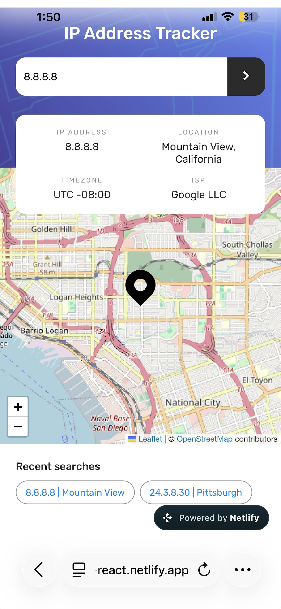

# IP Address Tracker (React)

A React + TypeScript app that shows the location of any IP address or domain on a map. Built for the Per Scholas React Development project, based on the [Frontend Mentor IP Address Tracker challenge](https://www.frontendmentor.io/challenges/ip-address-tracker-I8-0yYAH0).

- **Live site:** https://ip-address-react.netlify.app
- **Repo:** https://github.com/aubrey-strauss/ip-address-react
- **Learning notes:** [LEARNING-NOTES.md](./LEARNING-NOTES.md): every term I learned, every mistake I fixed
- **Time log:** [about 14 hours 50 minutes](./LEARNING-NOTES.md#time-log)




## Overview

Type an IP address (like `8.8.8.8`) or a domain (like `google.com`), and the app shows its IP, city, timezone, and internet provider, then flies the map to that spot. On first load it shows your own IP.

## Features

- 🔍 Search any **IP address or domain**, or see your own IP on first load
- 🗺️ **Interactive map** (Leaflet + OpenStreetMap) that flies to each new location
- 📋 Results card: IP, location, timezone, and internet provider (ISP)
- 🕘 **Recent searches**: last 5 lookups as buttons, so you can tap to look one up again
- ✅ **Input validation** catches typos before calling the API
- ⏳ **Loading message** and **friendly error messages**
- 📱 **Fully responsive**: tested on desktop, tablet, and a real iPhone 13 Pro Max
- ♿ **Accessible**: screen-reader labels, live announcements, and keyboard focus styles (**Lighthouse accessibility score: 100**)

## Built With

- **React 19** + **TypeScript**
- **Vite** (build tool)
- **Leaflet / React Leaflet** (map)
- **IPify Geolocation API** (IP and location data)
- **CSS** (Flexbox, Grid, media queries)
- **Netlify** (hosting)
- **Claude (Anthropic)**: AI tutor for step-by-step guidance, explanations, and debugging help. I typed and tested the code myself.

## React Concepts Used

| Concept                                               | Where                                                                                                       |
| ----------------------------------------------------- | ----------------------------------------------------------------------------------------------------------- |
| **Small, reusable components** with typed props       | `components/` (Header, SearchForm, InfoPanel, InfoItem, MapView, RecentSearches)                            |
| **`children` for composition**                        | `Header` wraps the search form; `InfoPanel` wraps the `InfoItem`s                                           |
| **`useState`** with immutable updates                 | Search text, form errors, and recent-search history (new arrays, never changed in place)                    |
| **Context API** for shared state                      | `context/IpContext.tsx` shares results, loading, errors, and history app-wide (no prop drilling)            |
| **Custom hooks**                                      | `hooks/useIpLookup.ts` (fetching + loading/error) and `useIpContext` (safe access to Context)               |
| **`useEffect`** with correct dependencies and cleanup | `useIpLookup` re-fetches only when the search changes, and cancels outdated requests with `AbortController` |
| **Lists with stable keys**                            | Recent searches use the IP address as the `key`, not the index                                              |
| **Conditional rendering**                             | Loading message, error messages, results card, and map only show when they have data                        |
| **Controlled form** with validation                   | `SearchForm` + `utils/validateQuery.ts`                                                                     |

## Run It Locally

1. Clone the repo and install packages:
   ```bash
   git clone https://github.com/aubrey-strauss/ip-address-react
   cd ip-address-react
   npm install
   ```
2. Get a free API key at [geo.ipify.org](https://geo.ipify.org).
3. Create a file named `.env.local` in the top folder with one line:
   ```
   VITE_IPIFY_KEY=at_UepZh7TYLH4vfu1YYy1zwqdBBuESc
   ```
4. Start the app:
   ```bash
   npm run dev
   ```

## Project Structure

```
src/
├── api/         fetchIpData.ts: calls the IPify API
├── components/  Header, SearchForm, InfoPanel, InfoItem, MapView, RecentSearches
├── context/     IpContext.tsx: shared app state
├── hooks/       useIpLookup.ts: fetching, loading, and errors
├── types/       ipData.ts: TypeScript shape of the API data
└── utils/       validateQuery.ts: checks searches before calling the API
```

## Challenges & Solutions

- **API key safety:** I accidentally pushed my key to GitHub early on. I reset it and moved it to `.env.local`, which Git ignores. On Netlify it's stored as an environment variable.
- **Map not following searches:** the map only uses its starting position once, so I wrote a small `FlyToLocation` helper with `useMap` + `useEffect`.
- **Real iPhone testing:** the layout looked fine in DevTools but not on my phone. I made the mobile card a compact 2×2 grid, kept the map from hijacking scrolling, and fixed a Safari bug where the card's text garbled during the map animation.

See [REFLECTION.md](./REFLECTION.md) for more.

## Note on the API Key

This is a front-end-only app, so the key is hidden from GitHub but still visible in the browser once deployed. That's fine for a class project; a production app would route requests through a small server.

## Author

**Aubrey Strauss**, Per Scholas Full Stack Development
